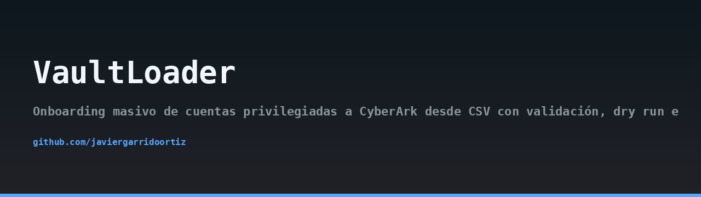
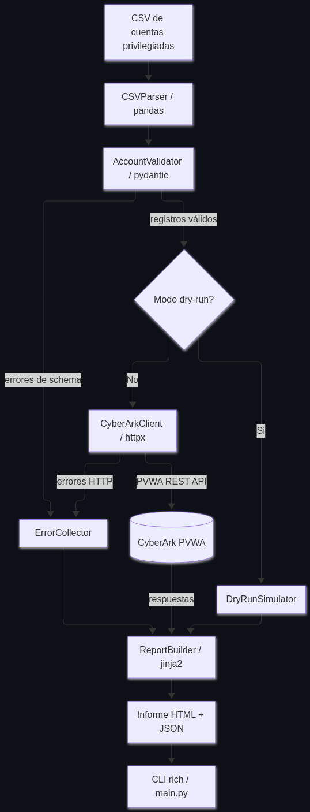
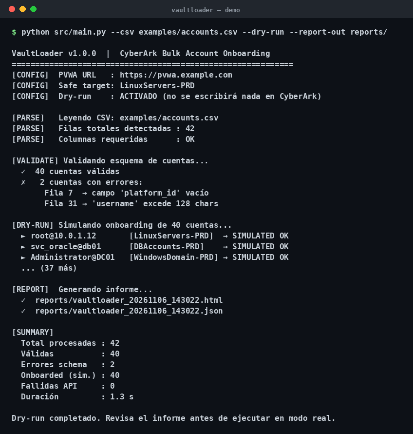

## Architecture



## Demo



# VaultLoader

> 🇪🇸 Read this in [Spanish](README.md).

VaultLoader is a command-line tool for massive onboarding of privileged accounts into CyberArk from a CSV file. It validates each row against the PVWA REST API v2 schema, supports dry-run mode to simulate the process without touching the real API, and generates detailed reports in HTML and JSON.

## Features

- **CSV ingestion**: reads and normalizes column names using pandas.
- **Schema validation**: uses Pydantic v2 models to verify required fields (`username`, `address`, `platform_id`, `safe_name`, `secret_type`), length restrictions, and allowed values.
- **Error collection**: accumulates invalid records with reference to the CSV row in an `ErrorCollector`.
- **Dry-run mode**: simulates account creation without contacting the real API, generating realistic responses.
- **Real execution**: authenticates against CyberArk PVWA REST API v2 using username/password or an environment token, creates accounts in the specified Safe, and captures enriched HTTP errors.
- **Detailed reports**: generates an HTML report (Jinja2) and a structured JSON report with successes, schema errors, and API errors.
- **Mock server**: includes a FastAPI-based mock server that replicates the `/auth/cyberark/api/accounts` and `/auth/cyberark/api/logon` endpoints for testing without a license.
- **CLI with Rich**: shows real-time progress and a final summary.

## Requirements

- Python 3.11 or higher
- Dependencies listed in `requirements.txt`:
  - httpx
  - pandas
  - pydantic>=2
  - rich
  - jinja2
  - pytest
  - fastapi (for the mock server)
  - uvicorn (for the mock server)

## Installation

1. Clone the repository:
   ```bash
   git clone https://github.com/your-org/VaultLoader.git
   cd VaultLoader
   ```

2. Create and activate a virtual environment:
   ```bash
   python -m venv venv
   source venv/bin/activate  # On Windows: venv\Scripts\activate
   ```

3. Install dependencies:
   ```bash
   pip install -r requirements.txt
   ```

## Usage

### Basic command

```bash
python src/main.py --csv examples/accounts.csv --output-dir reports
```

### Main options

- `--csv PATH`: path to the input CSV file (required).
- `--output-dir PATH`: directory where reports will be saved (default: `reports`).
- `--dry-run`: run in simulation mode without contacting the real API.
- `--pvwa-url URL`: base URL of the CyberArk PVWA (e.g., `https://pvwa.example.com`).
- `--username USER`: username for authentication.
- `--password PASS`: password for authentication.
- `--token TOKEN`: authentication token (alternative to username/password).

Credentials can also be provided via environment variables:
- `CYBERARK_USERNAME`
- `CYBERARK_PASSWORD`
- `CYBERARK_TOKEN`
- `CYBERARK_PVWA_URL`

### Examples

Dry-run with a sample CSV:
```bash
python src/main.py --csv examples/accounts.csv --dry-run --output-dir reports
```

Real execution against a PVWA:
```bash
python src/main.py --csv accounts.csv --pvwa-url https://pvwa.example.com --username admin --output-dir reports
```

Using an environment token:
```bash
CYBERARK_TOKEN=my-token python src/main.py --csv accounts.csv --pvwa-url https://pvwa.example.com
```

## CSV format

The input CSV must contain at least the following columns (case-insensitive, spaces and hyphens are normalized to underscores):

- `username`
- `address`
- `platform_id`
- `safe_name`
- `secret_type`

Additional columns are allowed and will be passed through to the API if recognized.

Example of a valid row:
```csv
username,address,platform_id,safe_name,secret_type
svc_backup,server01.corp.local,UnixSSH,MySafe,password
```

## Mock server

For testing without a CyberArk license, a mock server is included. Start it with:

```bash
uvicorn mock_server.server:app --reload --port 8000
```

The mock server implements:
- `POST /auth/cyberark/api/logon`
- `POST /auth/cyberark/api/accounts`

Use `--pvwa-url http://localhost:8000` to point VaultLoader to the mock server.

## Reports

After execution, two files are generated in the output directory:
- `report.html`: a human-readable HTML report with tables of successes and errors.
- `report.json`: a machine-readable JSON report with the same information.

## Testing

Run the test suite with:

```bash
pytest tests/
```

The tests cover CSV parsing, validation logic, and dry-run simulation.

## Project structure

```
VaultLoader/
├── README.md
├── README.en.md
├── src/
│   ├── main.py
│   ├── csv_parser.py
│   ├── validator.py
│   ├── cyberark_client.py
│   ├── dry_run.py
│   └── report_builder.py
├── templates/
│   └── report.html.j2
├── mock_server/
│   └── server.py
├── tests/
│   ├── test_validator.py
│   ├── test_csv_parser.py
│   └── test_dry_run.py
├── examples/
│   └── accounts.csv
├── requirements.txt
├── LICENSE
└── .gitignore
```

## License

This project is licensed under the MIT License. See the [LICENSE](LICENSE) file for details.

## Author

Javier Garrido Ortiz
