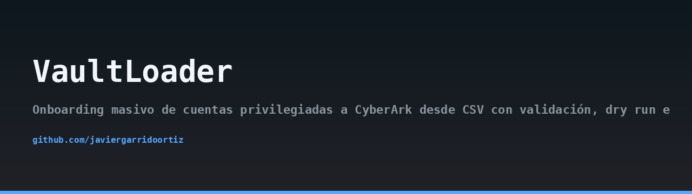
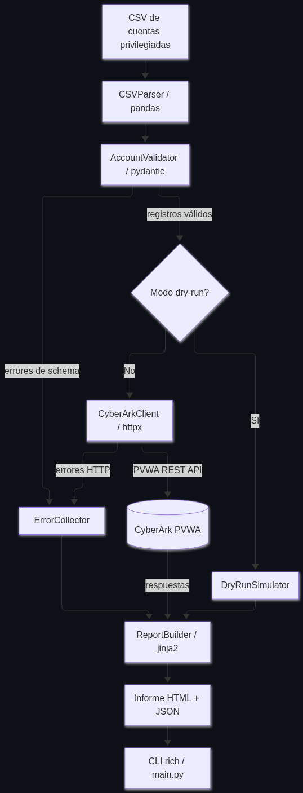
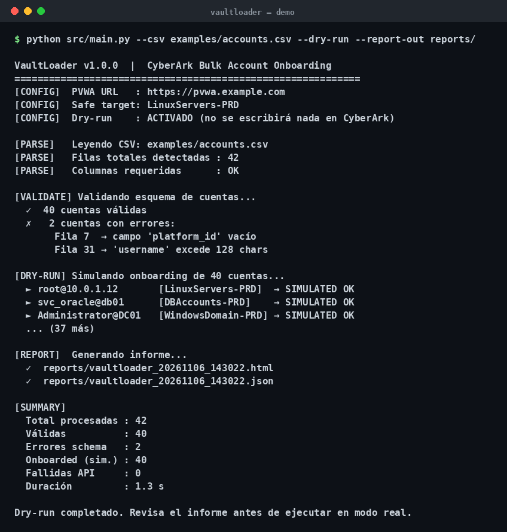
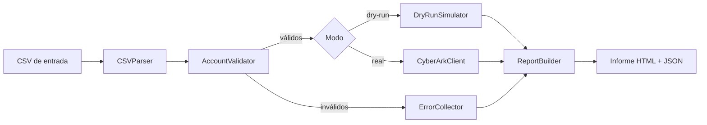

## Arquitectura



## Demo



> 🇬🇧 Read this in [English](README.en.md).

# VaultLoader


Herramienta de onboarding masivo de cuentas privilegiadas hacia CyberArk PVWA desde un fichero CSV, con validación estricta, modo *dry run* y generación de informes detallados en HTML y JSON.

## Descripción y motivación

En entornos de gestión de accesos privilegiados (PAM), dar de alta cuentas en la bóveda de CyberArk de forma manual es un proceso lento, propenso a errores y difícil de auditar. Un operador que teclea decenas o cientos de cuentas en la consola de la PVWA comete erratas en el `safe_name`, olvida el `platform_id` o duplica registros sin darse cuenta.

VaultLoader resuelve ese problema automatizando el flujo completo:

- Ingesta del CSV con normalización de cabeceras.
- Validación de cada fila contra el esquema que exige la PVWA REST API v2.
- Simulación previa (*dry run*) sin tocar la API real.
- Alta efectiva vía API con captura de errores HTTP enriquecidos.
- Informe final con éxitos, errores de esquema y errores de API, referenciando la fila original del CSV.

El objetivo es que un equipo de seguridad pueda migrar lotes de cuentas privilegiadas a la bóveda de forma reproducible, auditable y segura, reduciendo el riesgo de configuraciones incorrectas que podrían dejar cuentas fuera de control.

## Arquitectura

VaultLoader se organiza en cuatro capas desacopladas:

1. **Ingesta** (`src/csv_parser.py`): lee el CSV con pandas, normaliza nombres de columna y devuelve una lista de diccionarios crudos.
2. **Validación** (`src/validator.py`): modelos Pydantic v2 que comprueban campos obligatorios, longitudes y valores permitidos. Los registros inválidos se acumulan en un `ErrorCollector` con referencia a la fila CSV.
3. **Ejecución**: en modo *dry run* (`src/dry_run.py`) se generan respuestas simuladas; en modo real (`src/cyberark_client.py`) se autentica contra la PVWA REST API v2 con httpx async y se crean las cuentas en el Safe indicado.
4. **Informe** (`src/report_builder.py`): recibe todos los resultados y renderiza un HTML con Jinja2 y un JSON estructurado en el directorio de salida.

La CLI (`src/main.py`) orquesta el flujo con Rich y argparse, mostrando progreso en tiempo real y un resumen final.

Diagrama de flujo (Mermaid):



El servidor mock (`mock_server/server.py`, FastAPI) replica los endpoints `/auth/cyberark/api/logon` y `/auth/cyberark/api/accounts` para pruebas sin licencia de CyberArk.

## Requisitos

- Python 3.11 o superior.
- Acceso de red a la PVWA de CyberArk (solo en modo real).
- Credenciales de un usuario con permisos para crear cuentas en los Saves destino.

## Instalación

```bash
python3.11 -m venv .venv
source .venv/bin/activate
pip install -r requirements.txt
```

## Configuración

Todas las credenciales y parámetros sensibles se leen de variables de entorno. Nunca se almacenan en el repositorio.

| Variable | Descripción | Obligatoria |
|---|---|---|
| `PVWA_URL` | URL base de la PVWA, p. ej. `https://pvwa.example.com` | Sí (modo real) |
| `PVWA_USER` | Usuario para autenticación en la PVWA | Sí (modo real) |
| `PVWA_PASSWORD` | Contraseña del usuario | Sí (modo real) |
| `PVWA_VERIFY_SSL` | `true`/`false` para verificar el certificado TLS | No (por defecto `true`) |

Ejemplo:

```bash
export PVWA_URL="https://pvwa.example.com"
export PVWA_USER="svc-vaultloader"
export PVWA_PASSWORD="$(cat /run/secrets/pvwa_password)"
export PVWA_VERIFY_SSL="true"
```

## Formato del CSV de entrada

La primera fila debe contener las cabeceras. Los nombres de columna se normalizan a minúsculas y guiones bajos.

| Columna | Obligatoria | Descripción |
|---|---|---|
| `username` | Sí | Nombre de la cuenta privilegiada |
| `address` | Sí | Dirección del sistema destino (IP o FQDN) |
| `platform_id` | Sí | Identificador de la plataforma en CyberArk |
| `safe_name` | Sí | Safe destino donde se creará la cuenta |
| `secret_type` | Sí | Tipo de secreto (`password`, `sshkey`, etc.) |
| `secret` | No | Secreto inicial (si se omite, se genera en la bóveda) |
| `name` | No | Nombre lógico de la cuenta en la bóveda |
| `description` | No | Descripción libre |
| `cpmi_policy` | No | Política CPMI asociada |

Ejemplo mínimo:

```csv
username,address,platform_id,safe_name,secret_type
root,10.0.0.10,UnixSSH,PRIV-UNIX,password
admin,10.0.0.20,WinServerLocal,PRIV-WIN,password
```

## Uso

### Dry run (recomendado antes de cualquier alta real)

```bash
python -m src.main \
  --input examples/accounts.csv \
  --output ./out \
  --dry-run
```

### Modo real contra la PVWA

```bash
python -m src.main \
  --input examples/accounts.csv \
  --output ./out \
  --real
```

### Contra el mock server

```bash
python -m src.main \
  --input examples/accounts.csv \
  --output ./out \
  --real \
  --pvwa-url http://localhost:8000
```

La CLI muestra una barra de progreso por cada cuenta procesada y, al finalizar, un resumen con el número de éxitos, errores de validación y errores de API.

## Informes de salida

En el directorio indicado con `--output` se generan dos ficheros:

- `report.html`: informe legible con tablas por categoría (éxitos, errores de esquema, errores de API), incluyendo la fila CSV de origen de cada error.
- `report.json`: estructura máquina-legible con el mismo contenido, útil para integrarlo en pipelines de CI o sistemas de ticketing.

El JSON contiene un objeto raíz con las claves `summary`, `successes`, `schema_errors` y `api_errors`.

## Mock server

El servidor mock permite probar el flujo completo sin una instancia real de CyberArk.

```bash
uvicorn mock_server.server:app --port 8000
```

Endpoints simulados:

- `POST /auth/cyberark/api/logon`
- `POST /auth/cyberark/api/accounts`

## Tests

```bash
pytest -q
```

La suite cubre el parser de CSV, el validador Pydantic y el simulador de dry run. Los tests no requieren red ni credenciales.

## Contexto defensivo (MITRE ATT&CK)

El uso indebido de cuentas privilegiadas es una técnica recurrente en intrusiones: MITRE ATT&CK la recoge como **T1078 — Valid Accounts**. Mantener un inventario controlado y auditado de cuentas privilegiadas en la bóveda reduce la superficie de ataque y facilita la detección de cuentas no autorizadas. VaultLoader contribuye a ese control al forzar validación y trazabilidad en cada alta.

## Aviso de uso responsable

Esta herramienta está diseñada para administradores legítimos de entornos PAM. Úsala únicamente contra instancias de CyberArk sobre las que tengas autorización explícita. El autor no se responsabiliza del uso indebido del software.

## Licencia

MIT. Consulta el fichero [LICENSE](LICENSE) para el texto completo.

Autor: Javier Garrido Ortiz.
